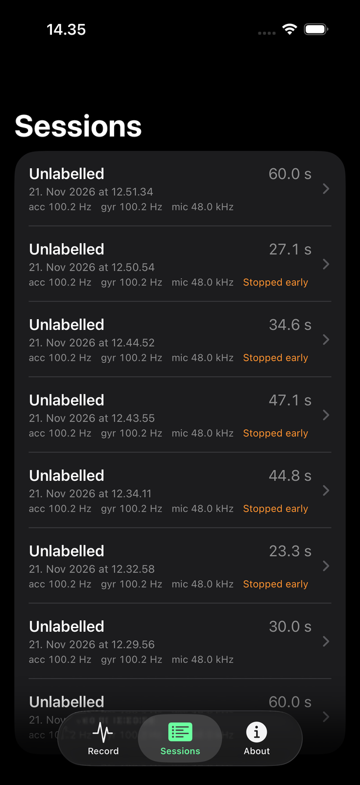
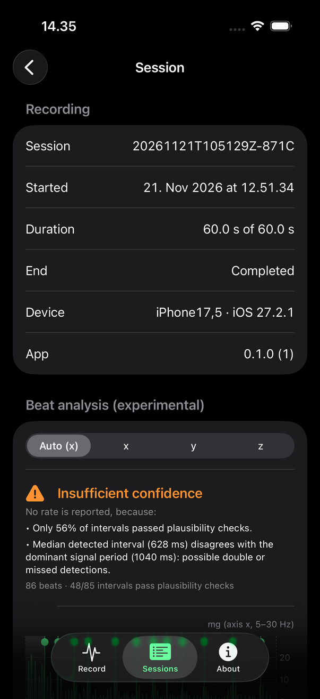
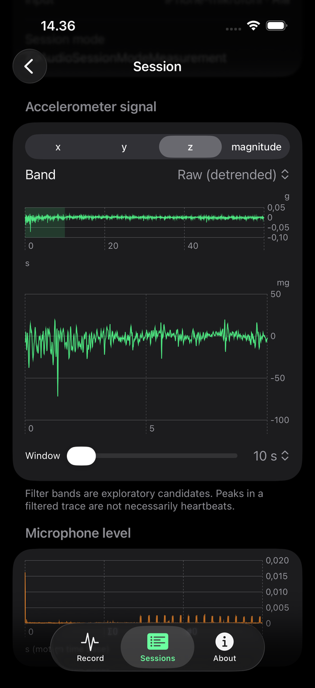
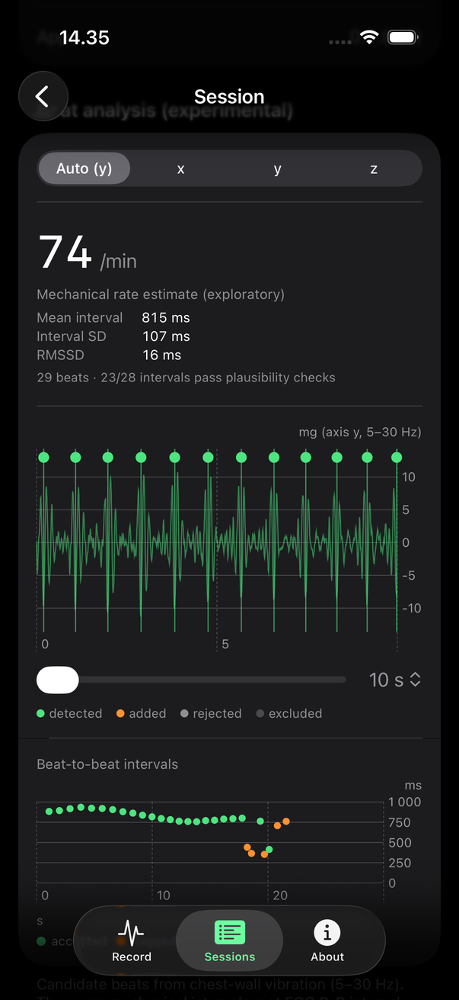
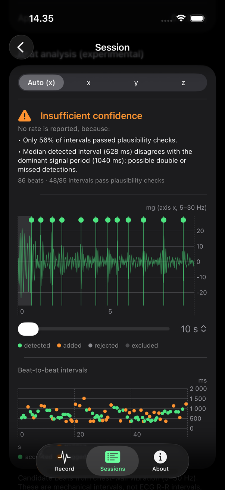
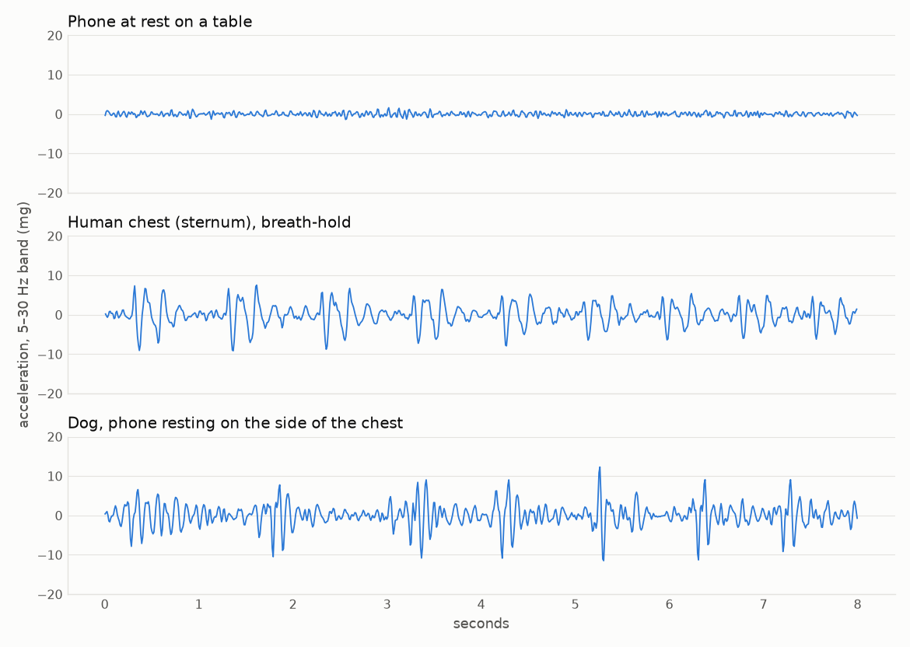
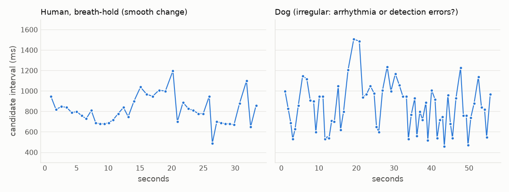
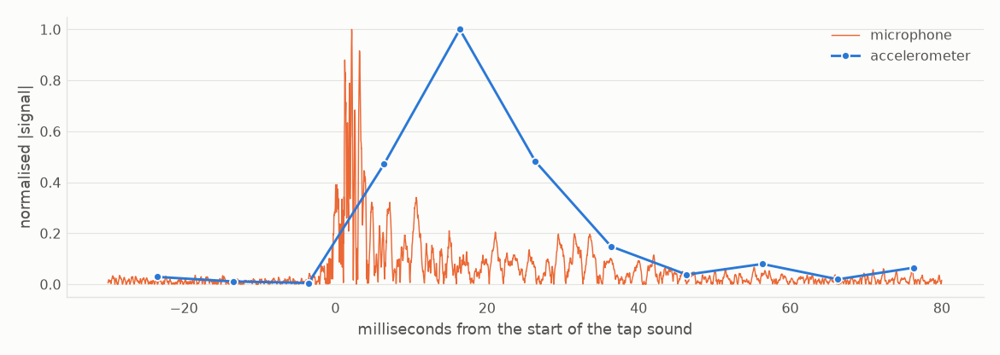

# CanineCardio

[English](README.md) · **Suomeksi**

Avoimen lähdekoodin iOS-tutkimussovellus, jolla selvitetään, pystyykö koiran rintakehällä kevyesti lepäävä iPhone havaitsemaan yksittäiset sydämenlyönnit ja mittaamaan lyöntien välit niin tarkasti, että hengityksen tahdissa vaihteleva syke (respiratorinen sinusarytmia) erottuu.

> [!WARNING]
> **CanineCardio on kokeellinen tutkimusohjelmisto.**
> Se **ei ole** lääkinnällinen eikä eläinlääkinnällinen laite, eikä sitä **ole validoitu koirien diagnostiikkaan**.
> Se **ei voi korvata eläinlääkärin EKG:tä** eikä eläinlääkärin tutkimusta.
> Älä käytä sitä minkään eläimen terveyttä koskevan päätöksen tekemiseen.

## Tila

| Vaihe | Sisältö | Tila |
|---|---|---|
| 1 | Raakasignaalin tallennus, reaaliaikainen näyttö, paikallinen tallennus, CSV/WAV-vienti | **Toteutettu ja käytössä iPhone 16e:llä.** |
| 2 | Signaalinkäsittely (suodattimet, huippujen tunnistus, lyöntivälit, laatu) | Toteutettu ja testattu. Toimii sovelluksessa tallennetuille istunnoille (kokeellinen lyöntianalyysi). Säädetty toistaiseksi vain synteettisellä datalla. |
| 3 | Analyysi (syke, lyöntivälisarja, RMSSD/SDNN, hengitys) | Osittain: lyöntivälitilastot ovat olemassa luotettavuustarkistuksen takana. Hengityksen arviointia ei ole aloitettu. |
| 4 | Analyysinäkymät | Osittain: lyöntianalyysi (lyöntiehdokkaat, lyöntivälit, luotettavuusarvio ja käsikorjaukset) sekä raaka ja suodatettu signaali. Tallennuksen aikana sykettä ei näytetä. |
| 5 | Validointi | Synteettiset skenaariot, pisteytys tunnettuja lyöntiaikoja vastaan, Python-analyysi, ensimmäiset oikeat tallennukset (alla). Vertailumittaukseen perustuvaa validointia ei vielä ole. |

## Kuvakaappaukset

| Istunnot | Istunnon tiedot | Tallennettu signaali |
|---|---|---|
|  |  |  |

| Lyöntianalyysi, ihmisen rintakehä | Lyöntianalyysi, koira |
|---|---|
|  |  |

Kuvat on otettu iOS-simulaattorista, ja niissä näkyvät iPhonesta kopioidut oikeat tallennukset. Ihmisen tallennukselle sovellus antaa sykkeen. Koiran tallennukselle se ilmoittaa **riittämättömän luotettavuuden** syineen eikä anna lukua.

## Alustavat tulokset (21.11.2026)

Nämä ovat ensimmäiset oikeat tallennukset: iPhone 16e (iOS 27.2.1), yksi aikuinen ihminen (kehittäjä) ja yksi rauhallinen, kyljellään makaava koira. **Samanaikaista vertailu-EKG:tä tai pulssin laskentaa ei tehty.** Tulokset kertovat, mitä signaaleja tallennuksissa on. Ne eivät kerro, kuinka tarkasti sydämenlyönnit tunnistetaan. Täydellinen loki on tiedostoissa [docs/VALIDATION.md](docs/VALIDATION.md) ja [docs/SYNCHRONIZATION.md](docs/SYNCHRONIZATION.md).

### Tallennuksen laatu

| Tarkistus | Tulos |
|---|---|
| Liikeanturien näytteenotto | Todellinen taajuus 100,2 Hz (pyydetty 100 Hz), näytevälit 9,973–9,981 ms, ei aukkoja yhdessäkään tallennuksessa |
| Kellojen tarkistus | Näytteet saapuvat sovellukseen 5,2 ms (mediaani) aikaleimansa jälkeen, joten liike- ja äänidatan kellot täsmäävät |
| Kohinataso, puhelin pöydällä | Noin 0,45 mg RMS kaistalla 5–30 Hz |
| Ääni | 48 kHz, ei katkoja, näytekellon ajautuma −15 ppm |
| Ääni vs. liike (koputustesti, 5 napautusta) | Kiihtyvyysanturi reagoi noin 5 ms äänen alkamisen jälkeen (huippu noin 16 ms) |

### Rintakehän värähtely: pöytä, ihminen ja koira

<picture>
  <source media="(prefers-color-scheme: dark)" srcset="docs/images/signals-dark.png">
  
</picture>

Kiihtyvyysanturin 5–30 Hz kaista, kustakin 8 s, kaikki samalla asteikolla. Pöydällä käyrä on tasainen. Ihmisen rintakehällä (rintalasta, hengitys pidätettynä) jokaisella sydämenlyönnillä näkyy noin 5–10 mg:n purske, joka on 10–20 kertaa kohinatasoa suurempi. Koiralla (puhelin vapaasti rintakehän kyljellä) samankokoisia purskeita näkyy koko tallennuksen 56 sekunnin rauhallisen jakson ajan.

### Lyöntivälit: avoin kysymys

<picture>
  <source media="(prefers-color-scheme: dark)" srcset="docs/images/intervals-dark.png">
  
</picture>

Lyöntiehdokkaiden välit kokeellisesta, jälkikäteen ajetusta tunnistimesta. Ihmisellä välit muuttuvat tasaisesti hengityksenpidätyksen aikana. Koiralla ne hyppivät noin 0,5 ja 1,5 sekunnin välillä. Myös käsin tunnusteltuna koiran pulssi tuntui hyvin epäsäännölliseltä, mikä viittaa siihen, että rytmi todella vaihtelee; voimakas sinusarytmia on koirilla yleistä. Ilman vertailua tunnistusvirheitä ei kuitenkaan voi sulkea pois, eikä datasta saa yksiselitteistä sykettä: taajuusanalyysi antaa noin 56/min ja lyöntivälien mediaani noin 71/min. Erillisessä tallennuksessa, jossa puhelin oli koiran lavan päällä, rytmi oli selkeämpi, noin 83/min.

### Äänen ja liikkeen synkronointi

<picture>
  <source media="(prefers-color-scheme: dark)" srcset="docs/images/tap-test-dark.png">
  
</picture>

Kynän napautus pöytään molempien anturien tallentamana, yhteisellä aikajanalla. Mikrofoni reagoi heti, ja kiihtyvyysanturi seuraa yhden tai kahden 10 ms:n näytteensä kuluessa.

### Mitä tämä osoittaa ja mitä ei

- ✅ Puhelin ja sovellus tallentavat selvän rintakehän värähtelyn (seismokardiogrammin) ihmiseltä ja samankaltaisia jaksollisia värähtelyjä levossa olevalta koiralta.
- ✅ Ajoitus on säännöllinen, ja anturit saadaan kohdistettua toisiinsa muutaman millisekunnin tarkkuudella.
- ❌ Vielä ei ole osoitettu, että jokainen koiralla tunnistettu purske on yksi sydämenlyönti tai että lyöntivälit ovat tarkkoja.
- Seuraavat askeleet:
  1. Mittaaja tunnustelee koiran pulssia (esim. kainalosta) ja naksauttaa kieltä jokaisella lyönnillä, jolloin sovelluksen mikrofoni tallentaa vertailun samalle aikajanalle.
  2. Sen jälkeen Polar H10 -EKG-sykevyö, jonka sovellus lukee suoraan Bluetoothilla; katso [docs/ROADMAP.md](docs/ROADMAP.md) (englanniksi).

## Mitä sovellus tekee (vaihe 1)

- Tallentaa **raa'an kiihtyvyysanturin** (g, painovoima mukana) ja **gyroskoopin** (rad/s) datan `CMMotionManager`illa pyydetyllä 100 Hz:n taajuudella. Jokainen näyte säilyttää oman aikaleimansa, ja sovellus raportoi todellisen näytteenottotaajuuden, näytevälien vaihtelun ja aukot. Se ei koskaan oleta näytteiden tulevan tasavälein.
- Tallentaa **käsittelemätöntä mikrofoniääntä** laitteiston näytteenottotaajuudella (tyypillisesti 48 kHz). Käytössä on `AVAudioEngine` ja `AVAudioSession`-tila `.measurement`, joka poistaa automaattisen tasonsäädön ja puheenkäsittelyn.
- Tallennuksen kesto on 30, 60 tai 120 s ja aloitusviive 0, 5 tai 10 s, jotta puhelimen ehtii asettaa paikalleen ennen tallennuksen alkua. **Preview**-tila näyttää signaalit tallentamatta.
- Näyttää reaaliajassa kiihtyvyyden, kiertonopeuden ja mikrofonin tason sekä ajastimen, mitatut näytteenottotaajuudet ja karkean liikeilmaisimen (Still / Slight motion / Moving). Liikeilmaisin kertoo vain liikkeestä, ei sydänsignaalin laadusta.
- Stop- ja Cancel-painikkeita pitää **painaa yhden sekunnin ajan**, jotta puhelinta rintakehälle asetettaessa tallennus ei pääty vahingossa.
- Tallentaa jokaisen istunnon paikallisesti ja vie sen CSV-muodossa (liike), WAV-muodossa (ääni) ja `metadata.json`-tiedostona jakovalikon tai Tiedostot-sovelluksen kautta.
- Listaa aiemmat istunnot näytteenoton diagnostiikkoineen. Jokaista istuntoa voi tarkastella raakana tai kaistanpäästösuodatettuna aaltomuotona zoomattavalla ikkunalla.
- **Lyöntianalyysi (kokeellinen)** jokaiselle tallennetulle istunnolle:
  - lyöntiehdokkaat rintakehän 5–30 Hz:n värähtelystä jokaiselta akselilta, ja luotettavin akseli valitaan automaattisesti
  - lyöntimerkit aaltomuodossa ja lyöntivälikaavio
  - syke, keskihajonta ja RMSSD näytetään **vain, kun luotettavuustarkistukset menevät läpi**; muuten näytetään "riittämätön luotettavuus" syineen
  - aaltomuotoa napauttamalla voi hylätä lyönnin tai lisätä uuden lähimpään värähtelyhuippuun. Korjaukset tallentuvat istuntokansioon tiedostoon `beats.json` ja lähtevät mukaan vientiin.
- Ei käyttäjätilejä, analytiikkaa, verkkoyhteyksiä eikä kolmannen osapuolen SDK:ita.

## Vaatimukset

- Xcode, jossa Swift 6 ja iOS 18+ SDK. Kehitetty ja testattu vain Xcode 27.2:lla. `project.yml` ilmoittaa yhteensopivuuden Xcode 16:n kanssa, mutta sitä ei ole testattu.
- iPhone oikeisiin tallennuksiin. Kehityksessä kohteena olivat iPhone 15 ja 16e. **iOS-simulaattorissa ei ole liikeantureita.** Sovellus kääntyy ja toimii siellä, mutta ilmoittaa kiihtyvyysanturin puuttuvan.
- Valinnainen: [XcodeGen](https://github.com/yonaskolb/XcodeGen) projektin uudelleenluontiin tiedostosta `project.yml`.
- Valinnainen, jälkikäteiseen analyysiin: Python 3.10+ sekä NumPy, SciPy ja Matplotlib.

Jatkuva integraatio: `.github/workflows/ci.yml` ajaa kirjaston testit, kääntää sovelluksen allekirjoittamattomana simulaattoria varten ja kokeilee Python-skriptin toimivuuden. Se ajetaan GitHubin macOS-koneilla (tällä hetkellä Xcode 26.6), joten koodi tarkistetaan myös kehityksessä käytettyä Xcode 27.2:ta vanhemmalla kääntäjällä.

## Kääntäminen ja asennus

```sh
git clone https://github.com/trotor/caninecardio.git
cd caninecardio
open CanineCardio.xcodeproj           # tai ensin: xcodegen generate
```

1. Luo tiedosto `Config/Signing.local.xcconfig` (git jättää sen huomiotta), jossa ovat oma tiimisi ja bundle ID:si:
   ```
   DEVELOPMENT_TEAM = ABCDE12345
   PRODUCT_BUNDLE_IDENTIFIER = com.yourdomain.caninecardio
   ```
   Repositoriossa on vain paikanvaraajat (`Config/Signing.xcconfig`).
2. Valitse iPhonesi ajokohteeksi ja käynnistä.
3. Salli mikrofonin käyttö pyydettäessä. Jos haluat tallentaa pelkän liikkeen, kytke pois **Record microphone audio**.

Testien ajaminen:

```sh
cd CardioKit && swift test            # kaikki kirjaston testit macOS:llä
xcodebuild test -scheme CardioKit-Package -destination 'platform=iOS Simulator,name=iPhone 17'
```

## Mittausohjeet

Mittaa vain rauhallista, levossa olevaa koiraa, joka sietää käsittelyä, ja vain omistajan luvalla. Lopeta heti, jos koira osoittaa minkäänlaista epämukavuutta.

1. Anna koiran asettua makaamaan kyljelleen tai rinnalleen. Kirjoita asento **Label**-kenttään yhdessä koiran tunnisteen ja puhelimen paikan kanssa.
2. Valitse kesto (aloita 60 sekunnilla) ja 5–10 sekunnin aloitusviive.
3. Napauta **Preview** ja tarkista, että aaltomuoto reagoi, ja napauta sitten **Record**.
4. Aseta puhelin aloitusviiveen aikana **näyttö ylöspäin** vasemmalle rintakehälle juuri kyynärpään taakse, kohtaan jossa sydämenlyönnit tuntuvat. Pidä kosketus kevyenä ja tasaisena. Ota kädet mahdollisuuksien mukaan pois puhelimelta; ensimmäisissä tallennuksissa mittaajan omaa pulssia ei voitu sulkea pois silloin, kun puhelinta pidettiin kädessä.
5. Ole hiljaa ja paikallasi, kunnes ajastin päättyy. Läähätys, nuoleminen, hännän heilutus ja käsittelyn äänet peittävät molemmat anturit.
6. Kirjaa jälkikäteen kaikki oleellinen, esimerkiksi jos koira liikahti tietyllä hetkellä.

Sovellus ei soita ääniä eikä värise tallennuksen aikana, koska ne sotkisivat signaalit. Näyttö pysyy päällä esikatselun ja tallennuksen ajan. Jos sovellus siirtyy taustalle tai äänisessio keskeytyy (esimerkiksi puhelun takia), tallennus pysähtyy ja tallennettu istunto merkitään **Interrupted**-tilaan.

## Tiedostomuoto

Jokainen istunto on kansio `Documents/Sessions/<id>/`, joka näkyy myös Tiedostot-sovelluksessa polussa *iPhonessa › CanineCardio › Sessions*:

| Tiedosto | Sisältö |
|---|---|
| `metadata.json` | Istunnon tunniste, nimike, kestot, päättymisen syy, laitemalli ja käyttöjärjestelmä, sovelluksen versio, kellon kuvaus, viiteaika, näytteenoton tilastot virroittain, äänen ajoitusarvot, huomiot ja varoitukset. Kirjoitetaan viimeisenä; kansio, josta se puuttuu, on keskeneräinen. |
| `accelerometer.csv` | `index,t_rel_s,t_uptime_s,received_uptime_s,x_g,y_g,z_g` |
| `gyroscope.csv` | `index,t_rel_s,t_uptime_s,received_uptime_s,x_rad_s,y_rad_s,z_rad_s` |
| `audio.wav` | Yleensä mono, 32-bittinen liukuluku-PCM laitteiston taajuudella, rajattu tallennusikkunaan. |
| `beats.json` | Vain käsikorjausten jälkeen: analyysin akseli, automaattisesti tunnistetut lyönnit sekä hylätyt ja lisätyt lyönnit (käynnistyksestä laskettuina sekunteina). |

- `t_uptime_s` on anturin aikaleima laitteen monotonisella käynnistyksestä laskettavalla kellolla.
- `t_rel_s = t_uptime_s − referenceUptimeS`, eli 0 on tallennuksen alku.
- `received_uptime_s` on hetki, jolloin sovellus vastaanotti näytteen; sitä käytetään viiveiden diagnostiikkaan.
- Rivit ovat raakanäytteitä saapumisjärjestyksessä, ei uudelleennäytteistettyjä.
- Äänen näyte *k* on samalla kellolla hetkellä `audio.firstFrameUptimeS + k / sampleRateHz`. Äänen ja liikkeen tarkka kohdistus on kuvattu tiedostossa [docs/SYNCHRONIZATION.md](docs/SYNCHRONIZATION.md).

Kansion [`examples/synthetic/`](examples/synthetic/) esimerkkiviennit ovat **SYNTEETTISIÄ**: ohjelman tuottamia, ei mitattuja. Ne näyttävät tiedostomuodon ja toimivat testiaineistona. Yllä kuvattuja oikeita tallennuksia ei ole julkaistu tässä repositoriossa.

## Jälkikäteinen analyysi

```sh
pip install -r analysis/requirements.txt
python analysis/analyze_session.py polku/<istuntokansio>                 # kirjoittaa <istunto>/analysis/*.png + report.json
python analysis/analyze_session.py examples/synthetic/SYNTHETIC-regular  # synteettinen esimerkki tunnetuilla lyöntiajoilla
python analysis/analyze_session.py <istunto> --reference ecg_r_peaks.csv # vertailu vertailulyönteihin
```

Skripti laskee näytteenoton diagnostiikan uudelleen ja piirtää raa'at ja suodatetut signaalit, Welch-spektrit ja mikrofonin verhokäyrän liikedatan aikajanalla. Kun sille annetaan vertailulyöntien ajat (synteettiset tunnetut ajat tai EKG:n R-piikit), se pisteyttää *lyöntiehdokkaat* herkkyyden, positiivisen ennustearvon ja ajoitusvirheen perusteella. Yllä olevat kuvat on tehty skriptillä `analysis/make_readme_figures.py`.

## Arkkitehtuuri

```
CanineCardio/            iOS-sovellus (SwiftUI): Record, Sessions, About
CardioKit/               Swift-paketti, jossa testattavat moduulit
  CardioCore             arvotyypit, näytteenoton tilastot, lukolla suojatut reaaliaikapuskurit
  Acquisition            Core Motion- ja AVAudioEngine-lähteet (iOS), CaptureGate, MeasurementSession
  Storage                istuntokansiot, CSV/JSON-tallennus
  SignalProcessing       Butterworth-suodattimet, filtfilt, uudelleennäytteistys, verhokäyrät,
                         huippujen tunnistus, lyöntivälit, artefaktimaskit, luotettavuusyhteenveto,
                         BeatMatcher-pisteytys
  SyntheticData          merkityt synteettiset signaalit tunnetuilla lyöntiajoilla (vain testit/esikatselut)
  cardio-synth           komentorivityökalu, joka kirjoittaa synteettiset esimerkki-istunnot
analysis/                Python-analyysi- ja kuvaskriptit
design/                  sovelluskuvakkeen generaattori
docs/                    arkkitehtuuri, synkronointi, validointisuunnitelma ja tulosloki
examples/synthetic/      synteettiset esimerkki-istunnot (esimerkki CSV-viennistä)
```

Analyysikoodi riippuu vain tallennetusta datasta, ei koskaan reaaliaikaisista antureista. Katso [docs/ARCHITECTURE.md](docs/ARCHITECTURE.md). Tarkemmat dokumentit ovat englanniksi.

## Mekaaniset lyönnit eivät ole EKG:n R-R-välejä

Kaikki tämän projektin tuottamat lyöntivälit perustuvat rintakehän **mekaanisiin** tapahtumiin: läppien sulkeutumisen ja veren ulospumppauksen värähtelyihin sekä koko kehon rekyyliin. Ne eivät ole sähköisiä R-R-välejä. Sähköisen aktivaation ja mekaanisten tapahtumien välinen viive (sähkömekaaninen viive eli esiejektioaika) vaihtelee lyönnistä toiseen. Siksi mekaaniset lyöntivälit poikkeavat EKG:n väleistä, ja eron suuruus on yksi mitattavista asioista. Projekti käyttää termejä "rytmin vaihtelu" ja "mahdollinen hengityksen aiheuttama vaihtelu". Se ei diagnosoi rytmihäiriöitä eikä muitakaan sairauksia.

## Lisenssi

MIT — katso [LICENSE](LICENSE).
